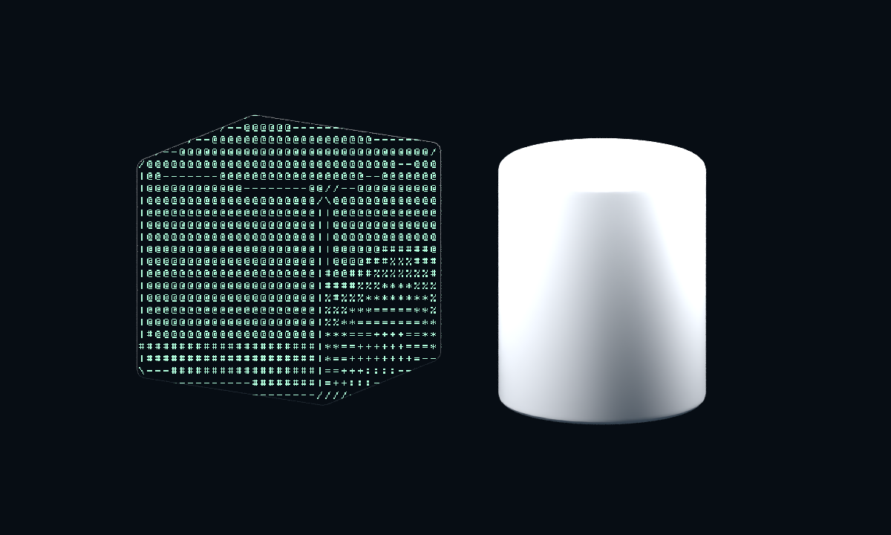
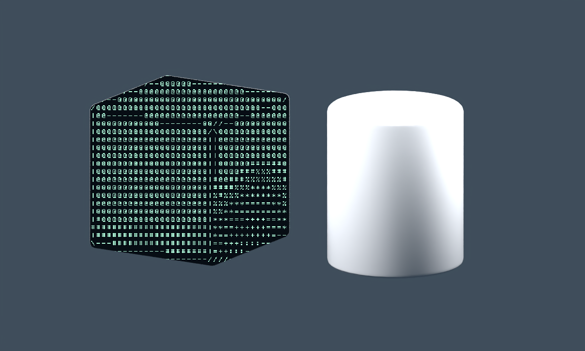
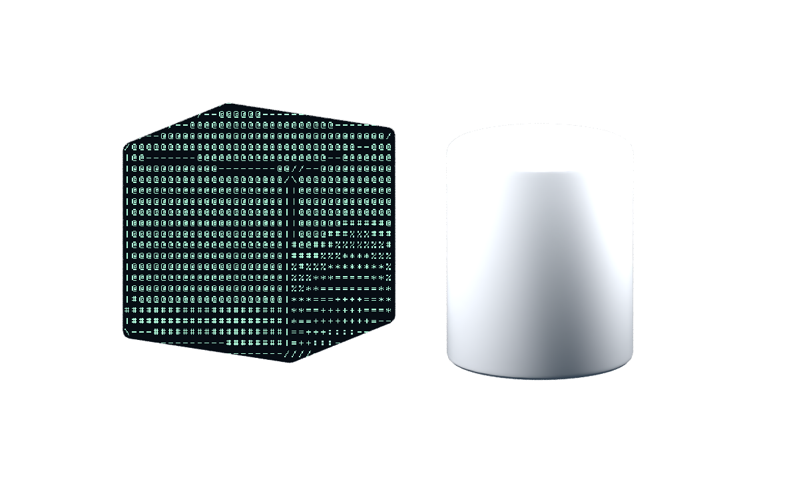
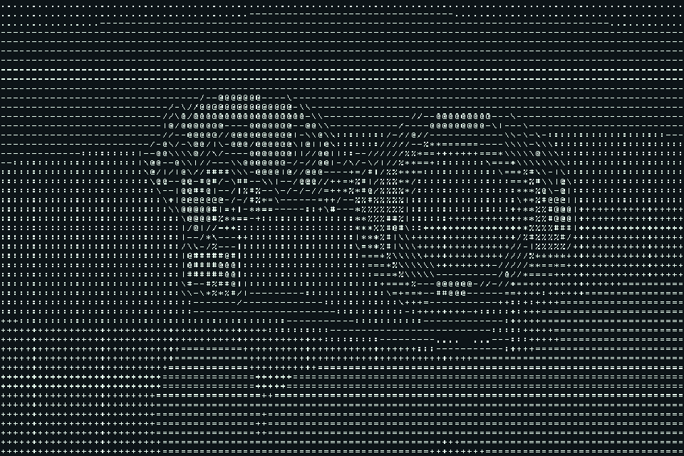
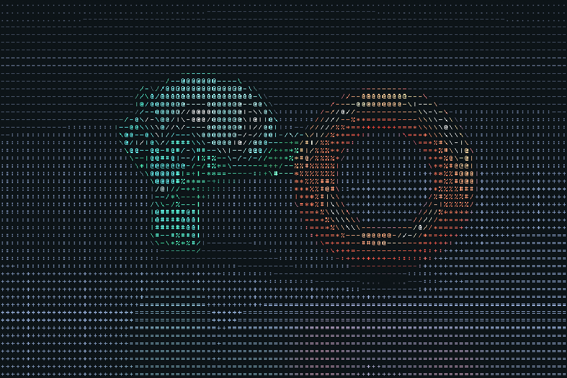
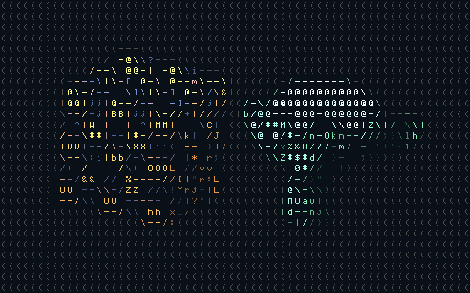
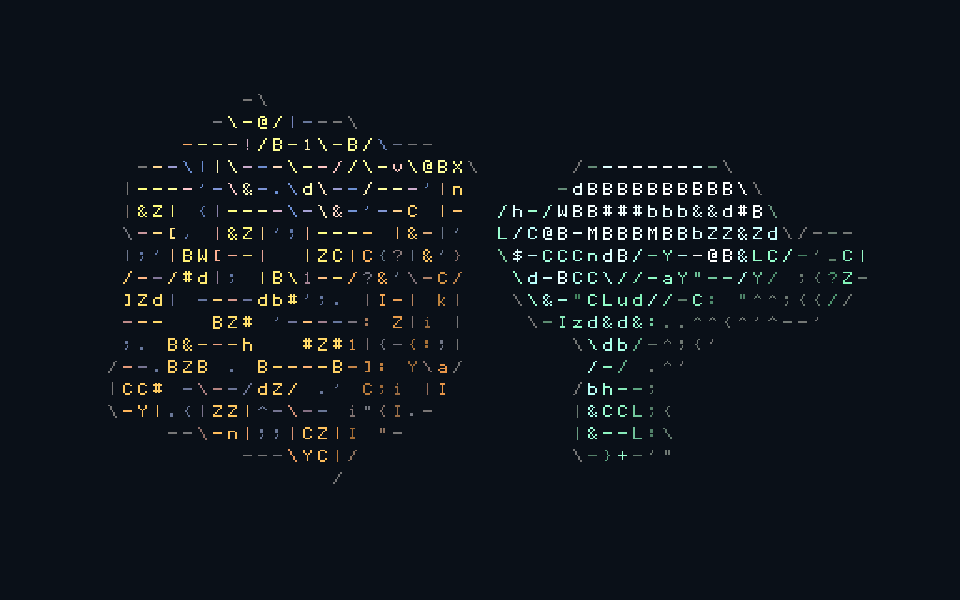

# ASCII Render

ASCII rendering for Blender, with live preview and animation. Apply it to the whole frame or mix ASCII objects with ordinary shaded objects.

**Blender 5.2 LTS** · **EEVEE & Cycles** · **GPL-3.0**

[Download 1.2.1](releases/ascii_render-1.2.1.zip?raw=1) · [Example scene](examples/selective.blend?raw=1) · [Русская инструкция](docs/README.ru.md)

*The cube uses ASCII; the cylinder keeps its original shading.*

## Install

1. Download **ascii_render-1.2.1.zip** using the link above. Keep it zipped.
2. In Blender, open **Edit → Preferences → Add-ons → ▼ → Install from Disk…**.
3. Select the ZIP and enable **ASCII Render**.
4. Open **N → ASCII** in the 3D Viewport and click **Add ASCII Render**.

The panel also lives in **Render Properties → ASCII Render**.
**F12** renders a frame; **Ctrl+F12** renders an animation using your usual output settings.

**1.2.1 fixes missing ASCII after upgrading an existing scene.** The migration now preserves input/output connections and repairs graphs damaged by 1.2.0 automatically, without resetting settings.

Version **1.2.0** adds Smart matching, clean silhouettes and reversible free-viewport preview. Repeated enable/reload remains supported.

## Viewport preview & grid

**Preview in Viewport** defaults to **Whole Viewport** (`Always`), including free views. Use **Rendered** or **Material Preview** shading; Solid cannot display the compositor. The add-on leaves shading and view direction under your control. **Camera** limits compositing to camera view (Numpad 0).

Disabling preview or Enable ASCII, removing the effect, or disabling/reloading the add-on restores the previous compositor setting for each affected space. Manual changes take precedence. Bookmarks are stored in Screen data inside the `.blend`, so restoration survives a file reload. New areas/windows and workspace changes are handled by events and a lightweight topology check every 0.75 seconds while preview is active.

**Grid Size → Columns** uses the input image's aspect ratio and keeps a consistent number of columns between viewport and F12. **Cell Pixels** keeps cell width in compositor input pixels, so different viewport/render resolutions produce different column counts. Viewport resolution scaling and HiDPI can change input pixel dimensions; these are not logical UI pixels. Smart clamps cell width to at least 8 input pixels to keep the atlas legible. Classic Columns retains the old grid, including tiny cells. Free view has its own aspect ratio and framing; camera view remains the closest match to the final render.

## Choose what becomes ASCII

Select an object and uncheck **Use ASCII on Active Object**. For several objects, use **Exclude Selected** or **Include Selected**. The same toggle is available in **Object Properties → ASCII Render → Use ASCII**.

The **World** setting controls the background:

| Mode | Result |
| --- | --- |
| ASCII | Convert the background along with the objects |
| Original | Keep the world texture or existing compositor background |
| Solid Color | Replace the world with the chosen background color |
| Transparent | Remove the world; keep both ASCII and shaded objects |

If your backdrop is a plane, exclude that plane as an object.
To export transparency, use PNG RGBA or OpenEXR.

**Remove Original Edge** is on by default. It fully replaces pixels whose ASCII-surface coverage exceeds **Edge Coverage Threshold** (default 0.01), eliminating the original shaded fringe. It does not expand the mask into the world or fully covered native objects. The silhouette, including transparent-world alpha, becomes harder; disable it for the original antialiased blend. At Strength below 1, the original is intentionally blended back. Full-frame ASCII already replaces the entire source image.

| Original world texture | Transparent world |
| :---: | :---: |
|  |  |

## Controls

| Monochrome | Scene colors |
| :---: | :---: |
|  |  |

- **Characters:** grid density, cell proportions, glyph size, four built-in ramps, or your own printable ASCII characters.
- **Tone:** density exposure, contrast, gamma and inversion.
- **Color:** foreground, background and scene-color brightness.
- **Contours:** directional line characters with an adjustable threshold, or switch them off.
- **Strength:** blend ASCII with the original image.

Start with **Terminal**, **Paper**, **Color** or **Coarse**. Presets keep your object exclusions and world mode.
Hover a numeric setting or color and press **I** to insert a keyframe.

## Smart matching (1.2.0)

**Matching → Classic** retains the 1.1 appearance and ramp order. **Smart** uses six samples per cell, a blurred, surface-weighted neighborhood and a noise floor for local tone adaptation. **Local Adaptation**, **Noise Floor**, and **Shape Matching** control these effects. Smart orders candidates by actual bitmap ink coverage, independently of custom ramp order, and compares 2×3 coverage descriptors of five neighboring candidates. Directional contours follow the brightness gradient. This is coarse shape matching, not exhaustive pixel matching; details smaller than a cell cannot be recovered, and animated threshold crossings can still flicker.

**Scale Variation**, **Minimum Scale**, and **Maximum Scale** vary individual glyph sizes with tone and edge importance. Smart clips glyphs to their cells. **Saturation**, **Color Brightness**, and **Minimum Contrast** control cell colors. Minimum Contrast is a linear-luminance difference against Background for opaque ink at full Strength, before the scene view transform. Transparent output uses Background as a reference; an arbitrary background added later cannot be guaranteed.

**Color Source → Diffuse Color** uses unlit diffuse color, without emission. It automatically falls back to Combined if the pass is missing (including Cycles live preview); the panel identifies this renderer limitation. Combined includes shading and emission. Surface-aware neighborhoods also fall back to image-only analysis when viewport passes are unavailable.

| Classic, 64 columns | Smart, 64 columns |
| :---: | :---: |
|  |  |

## Renderer support

Tested in **Blender 5.2.3 LTS on Windows**.

| Renderer | Full-frame live preview | Object/world masks in live preview | Still & animation renders |
| --- | :---: | :---: | :---: |
| EEVEE | Yes | Yes | Yes |
| Cycles (Rendered) | Yes | No | Yes |

Blender exposes the required viewport render passes in EEVEE. In Cycles, use **F12** to check object exclusions and world masks. The full-frame ASCII effect still has a live preview. See [Blender's viewport pass support](https://docs.blender.org/manual/en/latest/compositing/types/input/scene/render_layers.html).

Material Preview uses EEVEE, including when the final renderer is Cycles. Normal, Depth, Diffuse Color and shader AOVs were verified in the EEVEE free viewport; Cycles Rendered supplies only Combined to this effect. Object Index is not exposed by EEVEE, so selection uses a shader AOV.

The add-on runs entirely in Blender using native compositor nodes and a packed bitmap font atlas. No extra Python packages are needed.

Masking requires editable surface materials. It follows visible surfaces; reflections, transmitted images and volumes are not separate mask targets. If an existing compositor moves or distorts the image, apply the same transformation to the mask.

## Build & test

~~~sh
python tools/build.py
blender --background --factory-startup --python-exit-code 1 --python tests/render_smoke.py
blender --background --factory-startup --python-exit-code 1 --python tests/selective_render.py
blender --background --factory-startup --python-exit-code 1 --python tests/lifecycle.py
blender --background --factory-startup --python-exit-code 1 --python tests/smart_render.py
blender --background --factory-startup --python-exit-code 1 --python tests/smart_nodes.py
blender --background --factory-startup --python-exit-code 1 --python tests/edge_render.py
blender --background --factory-startup --python-exit-code 1 --python tests/viewport_preview.py
~~~

The ZIP is written to **dist/**. Test renders are written to **build/**.
See [1.2.0 validation and 1080p timings](docs/validation-1.2.0.md) and [development notes](docs/development.md) for GPU checks and the example scene.

## License & credits

[GPL-3.0-or-later](LICENSE). Inspired by [Baeac's ASCII art article](https://baeac.xyz/articles/ascii-art.html).
Examples rendered in Blender 5.2.3 LTS using this add-on.
