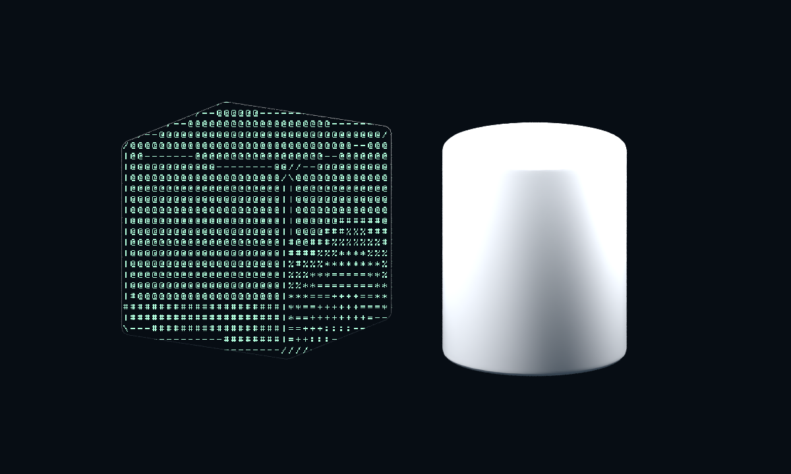
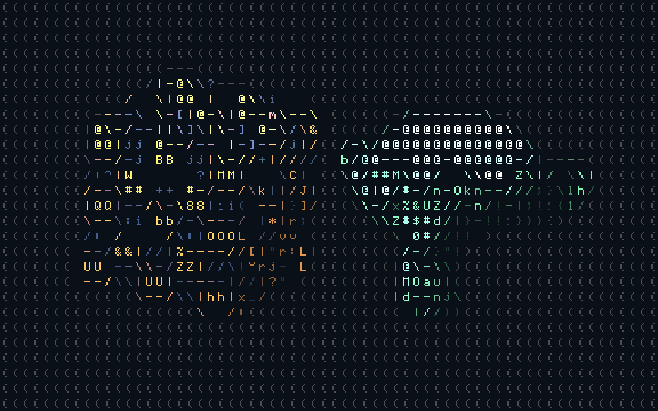
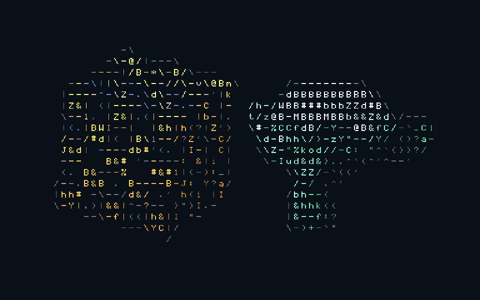

# ASCII Render

[English](../README.md) · [Скачать 1.2.0](../releases/ascii_render-1.2.0.zip?raw=1) · [Демосцена](../examples/selective.blend?raw=1)

Аддон для **Blender 5.2 LTS**, разработан и проверен в **5.2.3 LTS** на Windows.
Преобразует изображение сцены в ASCII через штатные ноды композитора.
Работает с предпросмотром в Rendered, одиночными кадрами и обычным рендером анимации.
Для работы не нужны pip, интернет, сторонние библиотеки или отдельный движок рендера.

## Установка

1. Возьми файл **dist/ascii_render-1.2.0.zip**. **Не распаковывай его.**
2. В Blender открой **Edit → Preferences → Add-ons**.
3. В меню **▼** справа сверху выбери **Install from Disk…**, укажи ZIP и подтверди установку.
4. Если аддон не включился автоматически, включи **ASCII Render**.

Версия **1.2.0** добавляет Smart, чистые силуэты и обратимый preview в свободном viewport. Повторное включение и reload по-прежнему поддерживаются.

## Первый запуск

1. Открой свою сцену с камерой.
2. Открой **Render Properties → ASCII Render** или боковую панель 3D-вида:
   **N → ASCII**.
3. Нажми **Add ASCII Render**. Аддон добавит эффект к выходу композитора,
   включит Preview in Viewport. Выбери Rendered или Material Preview вручную.
4. Выбери пресет **Terminal**, **Paper**, **Color** или **Coarse**.
5. Настрой символы, цвет и контуры. Изменения видны во вьюпорте.
6. **F12** — обычный рендер кадра, **Ctrl+F12** — рендер анимации.
   Файлы сохраняются в папку и формате, заданных в Output Properties.

**Preview in Viewport** показывает композитор и в свободном виде: по умолчанию
**Preview Area → Whole Viewport** соответствует Blender Always.
Режим Camera показывает эффект только из камеры (Numpad 0).
Shading и направление вида аддон не меняет; Solid не поддерживает композитор.
При выключении preview, Enable ASCII, удалении эффекта или отключении аддона
возвращается прежний use_compositor каждого затронутого space. Ручные изменения
пользователя сохраняются. Bookmarks хранятся в Screen внутри .blend и переживают reload.
Новые области и окна подхватываются через события и проверку топологии раз в 0.75 с;
Python не обрабатывает redraw или кадры изображения.

**Grid Size → Columns** сохраняет число колонок, а высота сетки вычисляется из
пропорций входного изображения и Cell Aspect. Это ближайшее соответствие viewport
и финального рендера, но свободный вид имеет другие пропорции и ракурс.
**Cell Pixels** сохраняет ширину ячейки в пикселях входа композитора; при разных
разрешениях viewport и F12 число колонок будет разным. Resolution scale / HiDPI
могут менять входное разрешение: это не логические пиксели UI. Smart ограничивает
ширину ячейки снизу 8 входными пикселями; Classic в Columns сохраняет старую сетку.

## Настройки

**Remove Original Edge** по умолчанию включён. Пиксели с вкладом ASCII-поверхности
выше **Edge Coverage Threshold** (0.01) полностью заменяются ASCII: сглаженная
маска больше не подмешивает исходный шейдинг. Маска не расширяется в мир или
на полностью покрытые обычные объекты, поэтому зазор не создаётся.
Цена — более жёсткий силуэт, в том числе альфа-край при прозрачном мире.
Выключение возвращает прежнее смешивание. При Strength<1 оригинал добавляется
намеренно. В full-frame исходное изображение уже полностью заменяется ASCII.

| Настройка | Что меняет |
| --- | --- |
| Enable ASCII | Включает эффект; выключение возвращает исходное изображение |
| Columns | Количество символов по ширине: больше — символы мельче |
| Cell Aspect | Отношение высоты ячейки к ширине |
| Glyph Scale | Размер знака внутри ячейки |
| Character Set | Classic, Detailed, Minimal, Dots & Circles или Custom |
| Characters | Собственная строка печатных ASCII-символов, максимум 128 |
| Sort by Ink Density | Сортирует символы по площади закрашенных пикселей |
| Color Mode | Monochrome — один цвет; Scene Colors — цвета сцены |
| Foreground / Background | Цвет знаков / цвет подложки |
| Color Brightness | Усиление яркости цветных символов |
| Density Exposure | Экспозиция для выбора плотности знаков, в ступенях |
| Contrast / Gamma | Контраст и полутона для выбора знаков |
| Invert Density | Меняет местами плотные и редкие знаки |
| Contours | Включает направление линий: дефис, вертикаль и две диагонали |
| Edge Threshold | Порог контуров: меньше — больше линий |
| Transparent Background | Прозрачность между символами вместо сплошной подложки |
| Strength | Смешивание с исходным изображением |

Custom поддерживает символы ASCII с кодами **32–126**, включая пробел.
Кириллица, emoji и управляющие знаки пропускаются; если поддерживаемых знаков
не осталось, используется Classic. Чтобы тёмные места были пустыми, включи
пробел в набор. При выключенной сортировке строка задаёт порядок от тёмного к светлому.
Шрифт встроенный, пиксельный 5×7; загрузка внешних TTF в эту версию не входит.

Числовые параметры, цвета и переключатели эффекта можно анимировать:
наведи курсор на поле и нажми **I**, либо используй контекстное меню Insert Keyframe.
Выбор набора, строка символов и сортировка общие для всей анимации.

## Как устроен эффект

### Smart в версии 1.2.0

**Matching → Classic** сохраняет алгоритм 1.1 и порядок пользовательского ramp.
**Smart** берёт шесть подвыборок внутри ячейки, сравнивает тон с размытой окрестностью
и использует **Noise Floor**, чтобы не усиливать шум плоских участков.
При доступной маске мир исключается из усреднения поверхностей.
**Local Adaptation** задаёт силу нормализации, **Shape Matching** — влияние формы.
Кандидаты сортируются по реальному покрытию bitmap, независимо от порядка Custom;
пять соседних кандидатов сравниваются по дескриптору покрытия 2×3.
Это приближённое сопоставление формы: мелкие детали внутри одного пикселя сетки
не восстановить; переключения символов в анимации могут мерцать.

**Scale Variation**, **Minimum Scale / Maximum Scale** меняют размер каждого знака
по тону и значимости границы. Smart ограничивает глиф границами ячейки.
**Saturation**, **Color Brightness** и **Minimum Contrast** управляют цветом.
Минимальный контраст — разница линейной яркости непрозрачных чернил и Background
при Strength=1, до View Transform. При прозрачной подложке это лишь опорный цвет;
контраст с произвольной подложкой, добавленной позднее, гарантировать нельзя.

**Color Source → Diffuse Color** берёт цвет без освещения и эмиссии.
При отсутствии пасса используется Combined; в Cycles live это явно указано в панели.
Combined сохраняет освещение и эмиссию. Без viewport-пассов нормализация работает
по изображению, без исключения мира по маске.

| Classic, 64 колонки | Smart, 64 колонки |
| :---: | :---: |
|  |  |

В Classic композитор вычисляет сетку из Columns и пропорций входного изображения,
усредняет цвет внутри каждой ячейки и выбирает знак по яркости. Для контуров
сравнивается яркость соседних точек; направление градиента выбирает один из
четырёх линейных символов. Это контуры изображения: они реагируют также
на тени и текстуры.

Глифы записываются в небольшую текстуру, автоматически упакованную в **.blend**.
Ноды работают в CPU- и GPU-композиторах. Параметры связаны со сценой
штатными драйверами Blender, поэтому анимация не зависит от Python-обработчиков кадров.
Обработка не создаёт текстовые 3D-объекты.

Add ASCII Render подключает эффект **перед активным Group Output** существующего
композитора. Viewer, подключённый к тому же изображению, переключается на ASCII.
Существующие File Output остаются со своими подключениями; при необходимости
подключи к ним выход группы ASCII Render вручную.
**Remove ASCII Effect** удаляет группу и восстанавливает исходное подключение.

Material Preview использует EEVEE даже при выбранном Cycles для F12.
В свободном EEVEE проверены Normal, Depth, Diffuse Color и shader AOV.
В Cycles Rendered дополнительные пассы пустые; Object Index в EEVEE не выдаётся.
Для отбора объектов используется AOV.

Замеры 1080p и результаты проверок: [validation-1.2.0.md](validation-1.2.0.md).

## Практические замечания

Выборочная обработка: выдели объект и выключи **Use ASCII on Active Object**,
либо используй **Include Selected / Exclude Selected**. В Object Properties
также есть переключатель **ASCII Render → Use ASCII**.
**World** выбирает ASCII, исходный фон (Original), сплошной цвет (Solid Color)
или прозрачность (Transparent). Текстуру на отдельной плоскости можно сохранить,
исключив саму плоскость.

Выборочные маски доступны в живом предпросмотре **EEVEE** и финальном рендере
**EEVEE / Cycles**. В Cycles-вьюпорте показывается ASCII всей сцены; маски
проверяй через F12.

- Предпросмотр требует режима **Rendered** и включённого композитора.
  Скорость зависит от движка сцены, разрешения и видеокарты; EEVEE обычно удобнее для интерактивной настройки.
- Для финального рендера должен быть включён **Use Compositing**.
- Сетка зависит от размеров входного изображения. При одинаковых пропорциях
  плотность символов во вьюпорте и финальном рендере совпадает; при разном
  разрешении возможна разница в сглаживании.
- Крупная сетка неизбежно теряет мелкие детали. Увеличь Columns, если объект плохо читается.
- Усреднение смягчает смену символов, но не устраняет её полностью:
  при пересечении порогов яркости знаки в анимации меняются.
- Density Exposure, Contrast и Gamma управляют выбором знаков в линейном
  композиторе с приближённой поправкой яркости. View Transform сцены не изменяется.
  Для прямого терминального вида удобно выбрать Standard вручную.
- Прозрачный результат сохраняй в формате с альфа-каналом, например PNG RGBA
  или OpenEXR. Обычный H.264 прозрачность не сохраняет.
- Выход — изображения или видео через Blender. Экспорт в TXT/ANSI не предусмотрен.
- Аддон должен быть включён при открытии проектов, использующих его настройки.
  При явном отключении аддона текущие значения сохраняются в нодах без драйверов.

## Разработка и проверка

Сборка ZIP (обычный Python):

~~~text
python tools/build.py
~~~

Проверки (путь к Blender подставь свой):

~~~text
blender --background --factory-startup --python-exit-code 1 --python tests/render_smoke.py
blender --background --factory-startup --python-exit-code 1 --python tests/gpu_smoke.py
blender --background --factory-startup --python-exit-code 1 --python tests/lifecycle.py
blender --background --factory-startup --python-exit-code 1 --python tests/selective_render.py
blender --background --factory-startup --python-exit-code 1 --python tests/smart_render.py
blender --background --factory-startup --python-exit-code 1 --python tests/smart_nodes.py
blender --background --factory-startup --python-exit-code 1 --python tests/edge_render.py
blender --background --factory-startup --python-exit-code 1 --python tests/viewport_preview.py
blender --background --factory-startup --command extension validate dist/ascii_render-1.2.0.zip
~~~

Рендеры, трёхкадровая анимация и демосцена сохраняются в **build/verification**.
Исходная идея — [статья Baeac](https://baeac.xyz/articles/ascii-art.html).
Реализация и встроенные глифы написаны для этого проекта.

Лицензия: GPL-3.0-or-later, полный текст — **ascii_render/LICENSE**.
